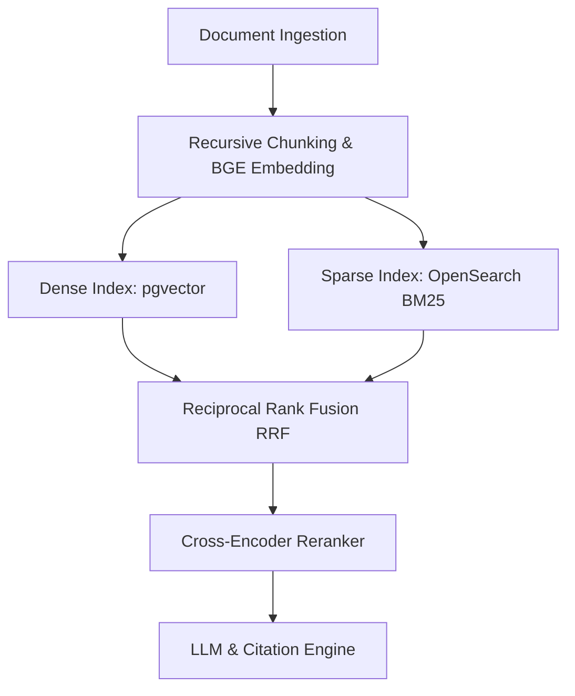

# AskMyDocs (Domain-Specific RAG Engine)


AskMyDocs is a domain-specific Retrieval-Augmented Generation (RAG) system built with Python, FastAPI, PostgreSQL (`pgvector`), OpenSearch, and LangChain. It implements a hybrid retrieval pipeline (Dense Vector + Sparse BM25) combined with Reciprocal Rank Fusion (RRF) and Cross-Encoder reranking to ensure source-grounded answers with verifiable inline citations.

---

## Key Features

- **Hybrid Retrieval:** Combines semantic vector search (`pgvector`) with exact keyword search (`OpenSearch` / BM25).
- **Reciprocal Rank Fusion (RRF) & Reranking:** Merges sparse and dense search scores and reranks candidates using Cross-Encoder models (`BAAI/bge-reranker-base`).
- **Enforced Source Citations:** Prompts and validates LLM outputs to trace every claim back to specific document chunk IDs.
- **Containerized Deployment:** Dockerized multi-stage builds with container orchestration via `docker-compose`.

---

## Tech Stack

- **Framework:** FastAPI, Uvicorn
- **Database & Vector Search:** PostgreSQL 16 + `pgvector` extension
- **Full-Text / Sparse Search:** OpenSearch 2.x (BM25)
- **Embeddings & Reranking:** `sentence-transformers` (`BAAI/bge-small-en-v1.5`, `BAAI/bge-reranker-base`)
- **Text Chunking:** `langchain-text-splitters`
- **Containerization:** Docker & Docker Compose

---

## Architecture Overview



---

## Project Structure

```text
askmydocs-backend/
├── app/
│   ├── __init__.py
│   ├── config.py
│   ├── main.py
│   ├── db/
│   │   ├── __init__.py
│   │   ├── postgres.py
│   │   └── opensearch.py
│   ├── models/
│   │   ├── __init__.py
│   │   └── schemas.py
│   └── services/
│       ├── __init__.py
│       ├── chunking.py
│       ├── embeddings.py
│       └── ingestion.py
├── .dockerignore
├── Dockerfile
├── docker-compose.yml
├── requirements.txt
└── README.md
```

---

## Getting Started

### Prerequisites

- [Docker](https://www.docker.com/) and [Docker Compose](https://docs.docker.com/compose/)
- Python 3.11+ (if running outside Docker)

### 1. Run with Docker Compose (Recommended)

Start the entire environment (FastAPI App, PostgreSQL + pgvector, OpenSearch):

```bash
docker compose up --build -d
```

Verify the containers are running:

```bash
docker compose ps
```

The API will be available at `http://localhost:8000`.

---

### 2. Local Setup (Without Docker for App)

1. **Start infrastructure services:**
   ```bash
   docker compose up db opensearch -d
   ```

2. **Create a virtual environment and install dependencies:**
   ```bash
   python -m venv venv
   source venv/bin/activate  # On Windows: venv\Scripts\activate
   pip install -r requirements.txt
   ```

3. **Run the FastAPI application:**
   ```bash
   uvicorn app.main:app --reload --host 0.0.0.0 --port 8000
   ```

---

## API Documentation

Once the app is running, visit the interactive Swagger UI at:
👉 **`http://localhost:8000/docs`**

### Core Endpoints

#### 1. Health Check
- **GET** `/health`
- **Response:** `{"status": "ok"}`

#### 2. Ingest Document
- **POST** `/api/v1/ingest`
- **Request Body:**
  ```json
  {
    "document_id": "doc_tech_spec_01",
    "content": "PostgreSQL with pgvector provides dense similarity search. OpenSearch handles full-text BM25 matching.",
    "metadata": {
      "category": "engineering",
      "author": "team"
    },
    "chunk_size": 500,
    "chunk_overlap": 50
  }
  ```
- **Response:**
  ```json
  {
    "document_id": "doc_tech_spec_01",
    "total_chunks": 1,
    "status": "SUCCESS"
  }
  ```

---

## License

Distributed under the MIT License. See `LICENSE` for details.